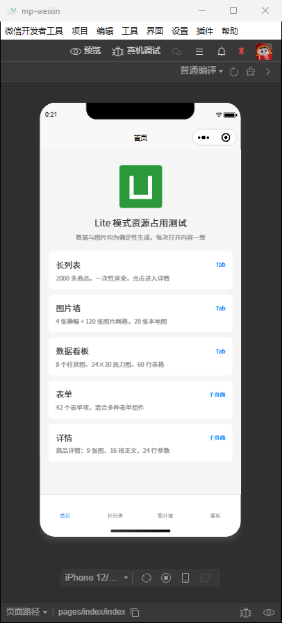
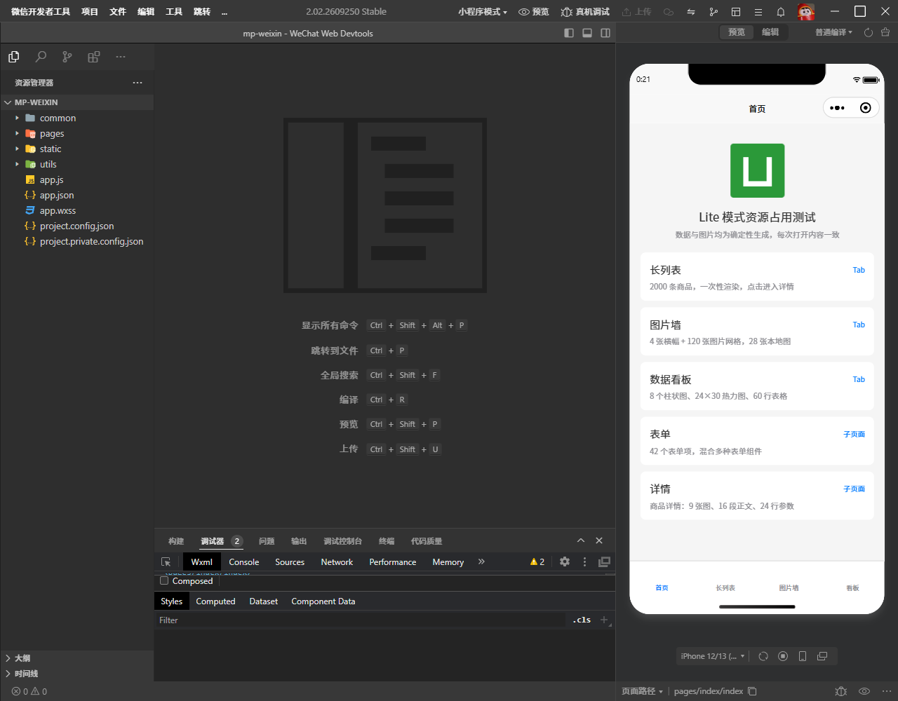

# Lite 模式缓解微信开发者工具卡顿，附 uni-app 实践方案

## 前言

众所周知，使用uni-app开发小程序的开发体验很差。

如果你的项目不是cli项目，那么你可能同时要开三个IDE，分别是hbuilder编辑器、VSCode编辑器、小程序开发者工具，一般的工作机同时开这三个简直是在坐牢。

目前，钉钉小程序开发者工具和抖音小程序开发者工具是有`切换至Lite模式`开关，而微信开发者工具是没有明确的`Lite`开关的。

本来是想研究能不能做个`微信开发者工具-网页版`来缓解卡顿，也算为业界做件好事，这是一个超级工程计划。

结果在分析微信开发者工具的安装目录时，偶然发现了官方已经内置的 Lite 模式，连对应的启动命令都已经写在 Skill 里了。最后只需要一串提示词就解决了，是我想多了。

## 摘要

本文介绍了`uni-app`小程序开发工作中，使用`微信开发者工具 Lite模式`来缓解低端机型卡顿的方法，并在后文给出`完整模式`和`Lite模式`的资源占用对比结果。

最终结论：Lite 模式少用约 0.9 GB 内存，降幅约 23%；启动阶段的 CPU 计算量少约四分之一，运行时 CPU 占用无明显改善。

本文一共介绍了两种启动`Lite模式`的方法：

1. wechatide内置命令
2. 使用我实现的Webpack/Vite插件

## Lite 模式和完整模式的区别

Lite模式主要阉割了整个代码编辑器，还阉割了调试器的部分功能。

如果你只用来调试样式，观察页面效果和代码输出，那么Lite模式完全够用。

Lite 模式默认只显示模拟器：



完整模式包含编辑器、调试器和模拟器：



| 功能                                               | Lite 模式                      | 完整模式 |
| -------------------------------------------------- | ------------------------------ | -------- |
| 小程序模拟器、页面运行                             | 保留                           | 保留     |
| 内置代码编辑器                                     | 不提供                         | 提供     |
| 内置调试器（Console、Network、WXML 检查、断点等）  | 精简，复杂调试需切换到完整模式 | 提供     |
| 编译运行服务、配合外部编辑器、CLI 预览/上传/自动化 | 相同                           | 相同     |

## 从安装目录里发现 Lite 模式

我先去看了本机开发者工具的安装目录。在追踪项目窗口的创建逻辑时，发现代码里出现了 `liteMode`，并且开窗入口能够选择窗口模式。

顺着这条线索继续找，又发现安装包内提供了一套 `wechatide-skill`。其中的 `initializer` Skill 明确写着：

```bash
wechatide -c <clientName> open_project_window --project <project> [--window-mode liteMode|fullMode]
```

也就是说，官方已经提供了启动 Lite 窗口的命令入口。

本次查看的安装包中，这份说明位于以下相对位置，具体安装根目录因电脑而异：

```text
resources/app.asar.unpacked/wechatide-skill/skills/initializer/SKILL.md
```

## 用官方命令启动 Lite 模式

### 先更新微信开发者工具

建议先更新到最新版，再使用下面的命令。旧版本可能没有提供相同的 `wechatide` 入口或参数。

正常安装并配置命令后，可以先在终端查看帮助：

```bash
wechatide --help
```

如果安装后仍提示找不到命令，先重新打开终端；终端集成在编辑器中时，需要重启编辑器，让新进程读取更新后的 PATH。

如果重启后还是找不到，可能是 PATH 没有加到安装根目录。本次测试的 Windows 环境中，PATH 里只有安装目录下的 `dll` 子目录，这时可以直接用完整路径调用（以默认安装路径、PowerShell 为例）：

```powershell
& "C:\Program Files (x86)\Tencent\微信web开发者工具\wechatide.cmd" --help
```

macOS 若入口未配置到 PATH，需要按官方安装指引补齐。

### 打开项目

以一个 Windows 工程为例：

```bash
wechatide -c uni-app open_project_window --project "C:/projects/my-uni-app/dist/dev/mp-weixin" --window-mode liteMode
```

把路径换成自己项目的小程序产物目录即可，路径中有空格时也要保留引号。

| 参数 | 含义 |
| --- | --- |
| `-c uni-app` | 调用方名称，用于识别和授权；这里使用 `uni-app` 作为名称 |
| `open_project_window` | 打开项目窗口 |
| `--project` | 微信小程序项目目录，uni-app CLI 工程通常指向构建产物 |
| `--window-mode liteMode` | 使用 Lite 模式创建窗口 |

首次以新的调用方名称连接时，可能需要在开发者工具中完成授权。如果返回结果是等待授权或确认，先完成对应交互，不要把命令已经返回当成窗口已经打开。

### 注意：项目路径要用绝对路径

下面这种写法，在本次使用的 Windows 版本中会报“项目路径不存在”：

```bash
wechatide -c uni-app open_project_window --project ./dist/dev/mp-weixin --window-mode liteMode
```

原因是 Windows 的 `wechatide.cmd` 在启动 CLI 前会切换到工具安装目录，相对路径不会按当前工程目录解析。官方 Skill 也要求路径参数使用本地绝对路径，直接传绝对路径即可。

### 已有窗口会被复用

如果相同项目已经开着，命令可能返回 `type: reuse`，复用原来的窗口。指定 `liteMode` 并不保证把一个已有的完整模式窗口切换为 Lite。

因此，如果发现执行后仍是原来的完整模式，先手动关闭该项目窗口，再重新执行命令。

## 在 uni-app CLI 工程中使用

### 方案一：在 package.json 中维护命令

在项目已有的 `scripts` 中增加一项，保留原来的开发命令：

```json
{
  "scripts": {
    "wx:lite": "wechatide -c uni-app open_project_window --project \"C:/projects/my-uni-app/dist/dev/mp-weixin\" --window-mode liteMode"
  }
}
```

上面的工程路径只是示例，需要替换成自己的绝对路径。

先正常运行开发命令：

```bash
npm run dev:mp-weixin
```

等待第一次编译完成，确认 `dist/dev/mp-weixin` 中已经生成小程序产物和 `project.config.json`，再开一个终端执行：

```bash
npm run wx:lite
```

这是配置最少的方案。如果只是希望方便地打开 Lite，维护这一条命令就足够了。

不足之处是需要手动执行，而且路径写死在配置里，换电脑或多人协作时都要调整。也可以额外写一个短脚本，用 `path.resolve()` 计算路径，再调用官方命令。

不要直接把启动命令接在持续编译命令的 `&&` 后面：

```text
持续编译命令 && Lite 开窗命令
```

watch 进程会一直运行，后面的命令要等前者成功退出才会执行，不能借此实现“首次编译成功就开窗”。

### 方案二：使用构建工具插件自动启动

如果希望只运行一次 `npm run dev:mp-weixin`，编译完成后就自动打开 Lite，可以接入构建工具插件。

这次探索中，我把这部分逻辑整理成了一个社区插件包，提供 webpack 和 Vite 两个入口：

[wechatide-lite-plugins](https://github.com/JUST-Limbo/wechatide-lite-plugins)

它调用的是本机开发者工具提供的命令，不包含开发者工具安装文件。

目前可以从 GitHub 安装：

```bash
npm install -D github:JUST-Limbo/wechatide-lite-plugins
```

#### webpack 工程

在已有的 `vue.config.js` 中合并插件配置：

```js
const WechatideLitePlugin = require("wechatide-lite-plugins/webpack")

module.exports = {
    configureWebpack: {
        plugins: [new WechatideLitePlugin()],
    },
}
```

这里展示的是最小配置，不要直接覆盖工程已有的 `configureWebpack`。如果本来使用 `chainWebpack`，也可以在已有函数中注册：

```js
config.plugin("wechatide-lite").use(WechatideLitePlugin)
```

#### Vite 工程

在已有的 `vite.config.js` 或 `vite.config.ts` 中引入插件，放在 uni-app 插件后面：

```js
import { defineConfig } from "vite"
import uni from "@dcloudio/vite-plugin-uni"
import wechatideLite from "wechatide-lite-plugins/vite"

export default defineConfig({
    plugins: [uni(), wechatideLite()],
})
```

保留项目原有的 uni-app 插件导入、注册方式，只追加 `wechatideLite()` 即可。不同工程模板对 `@dcloudio/vite-plugin-uni` 的导出处理可能不同，不必为了追加插件改写原有配置。

#### 接入后怎么用

修改构建配置后，停止原来的编译进程，重新运行：

```bash
npm run dev:mp-weixin
```

插件会在第一次编译成功后自动打开 Lite，同一开发进程后续热更新不会反复开窗，生产打包也不会触发。产物目录会自动转换为绝对路径，不需要在配置里写死本机路径。更多选项见插件仓库的说明。

## 效果对比

### 测试方法

- 机器：AMD Ryzen 7 7800X3D（8 核 16 线程）、32 GB 内存、Windows 11
- 开发者工具：2.02.2609250 Stable
- 测试项目：uni-app Vue3 + Vite 工程，共 6 个页面，包括 2000 条数据的长列表、120 张图的图片墙、数据看板、42 个表单项和详情页，小程序产物约 900 KB
- 测试流程：每轮先完全退出开发者工具，再用 `open_project_window` 冷启动项目，然后用 `wechatide` 自带的自动化命令依次切换页面并滚动到底，在 6 个时间点统计开发者工具全部进程的专用内存（Private Bytes）
- 两种模式交替各测 2 轮，取平均值。每个记录点都核对了窗口尺寸，确保测到的确实是对应模式

这次测试也有局限：只测了一台机器，每种模式 2 轮；两种模式都在自动化模式下运行；完整模式下编辑器没有打开任何文件；没有测量界面操作的流畅度。换成别的项目和机器，结果可能不同。

### 内存

| 记录点 | Lite 模式 | 完整模式 | 少用 | 降幅 |
| --- | --- | --- | --- | --- |
| 首页空闲 30 秒 | 2,914 MB | 3,724 MB | 810 MB | 21.8% |
| 长列表滚动到底 | 2,887 MB | 3,785 MB | 899 MB | 23.7% |
| 两次进出详情页 | 2,905 MB | 3,864 MB | 959 MB | 24.8% |
| 图片墙滚动到底 | 2,851 MB | 3,791 MB | 940 MB | 24.8% |
| 数据看板滚动到底 | 2,972 MB | 3,832 MB | 860 MB | 22.4% |
| 回首页静置 60 秒 | 2,934 MB | 3,759 MB | 824 MB | 21.9% |

同一模式两轮之间，每个记录点的差距都在 80 MB 以内，结果比较稳定。

### CPU 与启动

| 指标 | Lite 模式 | 完整模式 |
| --- | --- | --- |
| 开窗命令返回 | 约 3.7 秒 | 约 3.7 秒 |
| 首页可以截图 | 约 9.5 秒 | 约 10 秒 |
| 启动到首页空闲 30 秒的 CPU 时间 | 约 19.7 秒 | 约 26.7 秒 |
| 一整轮测试的 CPU 时间 | 约 42 秒 | 约 51 秒 |

CPU 时间是 CPU 实际执行程序所花的累计时间，多个核心同时工作时会叠加，反映的是计算量，不是耗时。

一整轮测试中，完整模式多用了约 9 秒 CPU 时间，其中约 7 秒出在启动阶段，应该是编辑器、终端等后台服务在初始化。页面操作阶段，两种模式的平均 CPU 占用相差不到 3 个百分点，换算到整机都在 1% 左右。

### 结论

在这个测试项目中，Lite 模式比完整模式少用约 0.8～0.96 GB 内存，降幅约 22%～25%。CPU 方面，Lite 启动阶段的 CPU 计算量少约四分之一，页面操作阶段两种模式基本相同。启动速度没有明显差别。

省下来的主要是编辑器相关的后台服务。完整模式多出了终端服务（ptyHost）、额外的 Node 服务进程和渲染进程，进程数从 Lite 的 22～25 个增加到 29～31 个。

但 Lite 并没有让开发者工具变得很轻。两种模式共有的部分仍接近 2.9 GB，其中编译器的 8 个工作进程按工作集计算就占了约 1.4 GB。Lite 更像是去掉了一层用不上的工作台，小程序的编译和运行环境并没有变。

如果机器内存本来就紧张，或者同时还开着 HBuilderX、VS Code，少掉的这 0.8 GB 左右还是有意义的，在低端机上对卡顿可能有明显缓解；在高性能设备上，内存和 CPU 都有充足余量，基本感知不到差别。

## 总结

如果你平时只用开发者工具看模拟器，Lite 模式能在不改变工作流的前提下省下约 0.9 GB 内存，值得一试。

Lite 也是官方 Skill 的默认窗口模式，适合 Agent 通过命令行驱动开发者工具。

从目前开发工具的发展趋势来看，未来软件开发的工作模式会从以人为中心转变为以AI为中心。不仅开发工具会出现巨大演进，整个行业的生产关系和生产模式也会发生根本性的变化。

不过不管未来发生什么，衷心的祝愿大家身心健康。

## 参考资料

- [微信开发者工具 Skills 官方文档](https://developers.weixin.qq.com/miniprogram/dev/devtools/Skills.html)
- 微信开发者工具安装包中的 `wechatide-skill/skills/initializer/SKILL.md`：开窗命令与窗口模式说明。
- 微信开发者工具安装包中的 `wechatide.cmd`、`skill-index.js`：本次 Windows 路径行为的调查依据。
- [webpack / Vite 插件及使用说明](https://github.com/JUST-Limbo/wechatide-lite-plugins)

本文涉及的安装目录调查和命令行为截至 2026 年 11 月，后续版本可能发生变化。
